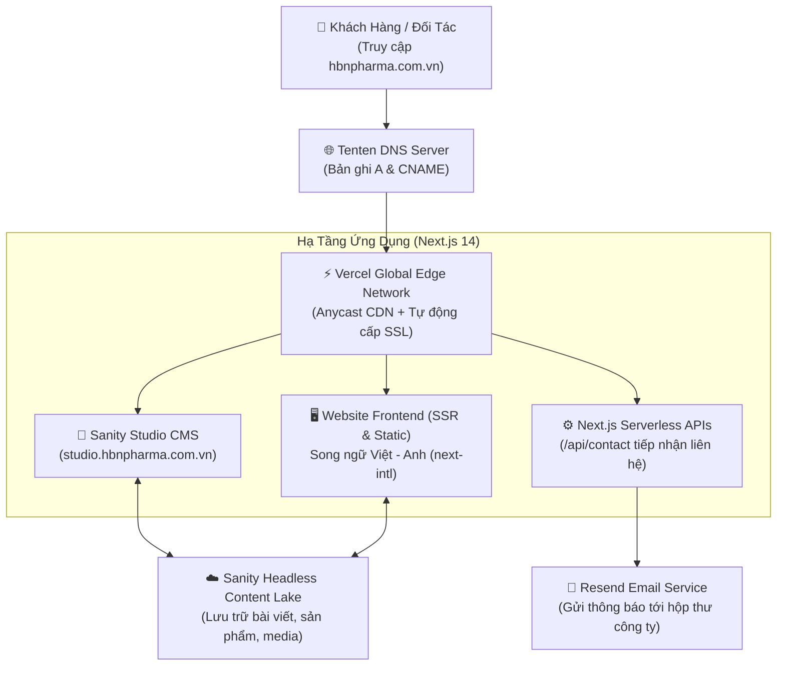

# Hướng Dẫn Bàn Giao & Triển Khai Website HBN Pharma (Go-Live Deployment Guide)

**Dự án:** Thiết kế lại Website Công ty Cổ Phần Dược Phẩm Hiệp Bách Niên (HBN Pharma)  
**Đơn vị thực hiện:** TechNova Studio  
**Ban kỹ thuật:**  
- Trần Minh Trí — PM & Tech Lead  
- Hoàng Quốc Huy — Backend Lead & DevOps  
- Lê Đăng Khoa — Senior Frontend Engineer  
- Đỗ Mai Phương — QA Lead  
- Vũ Thảo My — Client Success Lead  
**Ngày phát hành:** 26/11/2026  
**Phiên bản:** 1.0 (Production Ready)  

---

## 1. Tổng Quan Kiến Trúc Vận Hành (Production Architecture)



### Ưu điểm vượt trội của mô hình này:
- **Chi phí vận hành hàng tháng:** **0 VNĐ/tháng** (Free Tier Vercel + Free Tier Sanity + Free Tier Resend).
- **Tốc độ tải trang:** Phục vụ bởi hơn 100 điểm Edge POP trên toàn cầu, thời gian phản hồi (TTFB) < 100ms.
- **Bảo mật tuyệt đối:** Chứng chỉ bảo mật SSL tự động gia hạn, cách ly hoàn toàn database với môi trường public.
- **Không phụ thuộc hosting Windows:** Không cần nâng cấp gói hosting Tenten, chỉ sử dụng Tenten làm nhà đăng ký tên miền (Domain Registrar).

---

## 2. Danh Sách Tài Khoản & Chuẩn Bị (Pre-requisites)

| STT | Nền tảng | Mục đích | Tình trạng |
|---|---|---|---|
| 1 | **Tenten (navi.tenten.vn)** | Quản trị tên miền `hbnpharma.com.vn` và cấu hình bản ghi DNS | Đã có sẵn của khách hàng |
| 2 | **GitHub (github.com)** | Lưu trữ mã nguồn phiên bản, kết nối CI/CD tự động | Tạo mới hoặc dùng tài khoản có sẵn |
| 3 | **Vercel (vercel.com)** | Máy chủ đám mây Edge Hosting chạy Next.js 14 & SSL | Đăng ký miễn phí (kết nối qua GitHub) |
| 4 | **Sanity.io** | Cơ sở dữ liệu và giao diện biên tập nội dung bài viết, sản phẩm | Đăng ký miễn phí |
| 5 | **Resend (resend.com)** | Cổng API gửi email thông báo từ form liên hệ khách hàng | Đăng ký miễn phí (100 email/ngày) |

---

## 3. Quy Trình Triển Khai Từng Bước (Step-by-Step)

### Bước 1: Đẩy Mã Nguồn Lên GitHub

Mã nguồn hoàn chỉnh nằm tại thư mục: `projects/hbn-pharma/`.

Mở cửa sổ dòng lệnh Terminal/PowerShell và thực hiện:

```bash
cd "projects/hbn-pharma"

# 1. Khởi tạo kho mã nguồn Git
git init

# 2. Thêm toàn bộ mã nguồn vào staging
git add .

# 3. Commit phiên bản bàn giao
git commit -m "feat: release hbn-pharma corporate website v1.0"

# 4. Đổi tên nhánh chính thành main
git branch -M main

# 5. Thêm liên kết remote repository GitHub của bạn
git remote add origin https://github.com/<ten-tai-khoan-github>/hbn-pharma-website.git

# 6. Đẩy mã nguồn lên GitHub
git push -u origin main
```

---

### Bước 2: Khởi Tạo Sanity CMS & Lấy Khóa Cấu Hình

1. Truy cập [https://www.sanity.io](https://www.sanity.io) và đăng nhập (bằng GitHub hoặc Google).
2. Tạo dự án mới:
   - Tên dự án: `HBN Pharma Website`
   - Dataset mặc định: `production`
3. Lấy thông tin cấu hình tại mục **Project Settings**:
   - **Project ID:** Chuỗi ký tự (ví dụ: `8a7b9cde`)
   - **Dataset Name:** `production`
4. Cấu hình bảo mật CORS (để website được phép lấy dữ liệu):
   - Vào **API** $\rightarrow$ **CORS Origins** $\rightarrow$ **Add CORS Origin**.
   - Thêm: `https://hbnpharma.com.vn` (Tích chọn *Allow credentials*).
   - Thêm: `https://www.hbnpharma.com.vn` (Tích chọn *Allow credentials*).
   - Thêm: `http://localhost:3000` (để dev/test nội bộ).

---

### Bước 3: Khởi Tạo Khóa Gửi Email (Resend)

1. Truy cập [https://resend.com](https://resend.com), đăng ký tài khoản miễn phí.
2. Vào mục **API Keys** $\rightarrow$ Chọn **Create API Key**.
3. Đặt tên `HBN Pharma Website Form` $\rightarrow$ Nhấn Create và sao chép mã khóa (dạng `re_xxxxxxxxxxxx`).

---

### Bước 4: Deploy Ứng Dụng Lên Vercel

1. Truy cập [https://vercel.com](https://vercel.com) $\rightarrow$ Đăng nhập bằng tài khoản GitHub ở Bước 1.
2. Tại bảng điều khiển Dashboard, nhấn **Add New...** $\rightarrow$ Chọn **Project**.
3. Tìm repository `hbn-pharma-website` và nhấn **Import**.
4. Cấu hình triển khai:
   - **Framework Preset:** Giữ nguyên `Next.js`.
   - **Root Directory:** `./` (nếu repo là thư mục gốc dự án).
   - **Environment Variables (Biến môi trường):** Bấm mở rộng và điền các khóa sau:

| Tên biến (Key) | Giá trị mẫu (Value) | Giải thích |
|---|---|---|
| `NEXT_PUBLIC_SANITY_PROJECT_ID` | `8a7b9cde` | Project ID lấy từ Sanity ở Bước 2 |
| `NEXT_PUBLIC_SANITY_DATASET` | `production` | Tên Dataset Sanity |
| `RESEND_API_KEY` | `re_1234567890abcdef` | Khóa API lấy từ Resend ở Bước 3 |
| `CONTACT_EMAIL` | `info@hbnpharma.com.vn` | Hộp thư công ty nhận thông tin khách gửi |

5. Nhấn **Deploy**. Quá trình build tự động sẽ hoàn tất trong 1 - 2 phút. Sau khi xong, Vercel sẽ cấp một tên miền xem trước dạng `hbn-pharma-website.vercel.app`.

---

### Bước 5: Cấu Hình Tên Miền & DNS Tại Tenten

Đây là bước quyết định để chuyển đổi lượng truy cập từ website cũ sang nền tảng mới:

1. Đăng nhập trang quản lý dịch vụ Tenten: [https://navi.tenten.vn/](https://navi.tenten.vn/)
2. Vào mục **Dịch vụ của tôi** $\rightarrow$ **Tên miền** $\rightarrow$ Chọn **Quản lý DNS** của `hbnpharma.com.vn`.
3. Nhập chính xác bảng cấu hình sau:

| Loại bản ghi (Type) | Tên bản ghi (Host / Name) | Giá trị đích (Points to / Value) | TTL | Mục đích |
|---|---|---|---|---|
| **A** | `@` | `76.76.21.21` | 300 | Trỏ tên miền gốc `hbnpharma.com.vn` về Vercel Anycast IP |
| **CNAME** | `www` | `cname.vercel-dns.com` | 300 | Hỗ trợ truy cập qua `www.hbnpharma.com.vn` |
| **CNAME** | `studio` | `cname.vercel-dns.com` | 300 | Phân vùng quản trị CMS `studio.hbnpharma.com.vn` |

4. Thêm tên miền vào Vercel:
   - Quay lại trang quản trị dự án trên Vercel $\rightarrow$ Chọn **Settings** $\rightarrow$ **Domains**.
   - Nhập `hbnpharma.com.vn` và nhấn **Add** (chọn chế độ chuyển hướng tự động `www` về non-www hoặc ngược lại tùy nhu cầu).
   - Thêm tiếp `studio.hbnpharma.com.vn`.
   - Hệ thống Vercel sẽ tự động phát hiện bản ghi DNS Tenten đã trỏ và cấp chứng chỉ bảo mật SSL (HTTPS) màu xanh trong vòng 5 - 15 phút.

---

## 4. Danh Sách Kiểm Tra Nghiệm Thu (Post-Launch Checklist)

- [ ] **HTTPS / SSL:** Truy cập `https://hbnpharma.com.vn` hiển thị ổ khóa an toàn, không có cảnh báo bảo mật.
- [ ] **Đa ngôn ngữ:** Nhấp nút chuyển đổi `[VI | EN]` trên thanh Navbar:
  - Trang đổi ngôn ngữ tức thời, không bị lỗi 404.
  - Các đường link giữ đúng tiền tố `/vi` hoặc `/en`.
- [ ] **Form liên hệ:** Gửi một thông tin thử nghiệm tại trang Liên hệ $\rightarrow$ Hộp thư `info@hbnpharma.com.vn` nhận được email báo ngay lập tức.
- [ ] **CMS Quản trị:** Truy cập `https://studio.hbnpharma.com.vn`, đăng nhập thêm thử 1 sản phẩm mẫu hoặc bài viết mới $\rightarrow$ Dữ liệu xuất hiện ngay trên trang Sản phẩm/Tin tức.
- [ ] **Giao diện di động:** Mở website trên điện thoại di động (iPhone/Android), menu trượt mở êm ái, hình ảnh và khối chữ không bị tràn màn hình.

---

## 5. Quy Trình TechNova Hỗ Trợ Trực Tiếp (Live Support Program)

Nhằm đảm bảo quá trình chuyển đổi diễn ra an toàn 100%, không gián đoạn liên lạc hay hoạt động kinh doanh của HBN Pharma, TechNova Studio cung cấp **2 phương thức hỗ trợ trực tiếp**:

### Phương án A: Ủy quyền cấu hình trọn gói (TechNova thực hiện toàn bộ)
- Bạn tạo tài khoản phụ (hoặc cấp quyền tạm thời) cho team TechNova:
  - Mời email kỹ thuật: `devops@technova.studio` vào Vercel Team & Sanity Project.
  - Cung cấp thông tin truy cập trang DNS Tenten (sau khi hoàn thành bạn có thể đổi lại mật khẩu).
- Backend Lead Hoàng Quốc Huy & PM Trần Minh Trí sẽ trực tiếp cấu hình, test toàn bộ bản ghi và bàn giao hệ thống chìa khóa trao tay.

### Phương án B: Họp trực tuyến chia sẻ màn hình 1-1 (Interactive Live Session)
- Thời lượng: 20 – 30 phút.
- Hình thức: Google Meet hoặc qua phần mềm điều khiển từ xa (UltraViewer / TeamViewer / AnyDesk).
- Đội ngũ Tech Lead sẽ đồng hành trực tiếp, hướng dẫn bạn bấm từng nút và kiểm tra thông số theo thời gian thực cho đến khi website chính thức chạy mượt mà trên Internet.

---

*Tài liệu được bảo chứng kỹ thuật bởi TechNova Studio — Đơn vị đồng hành chuyển đổi số cho doanh nghiệp.*
